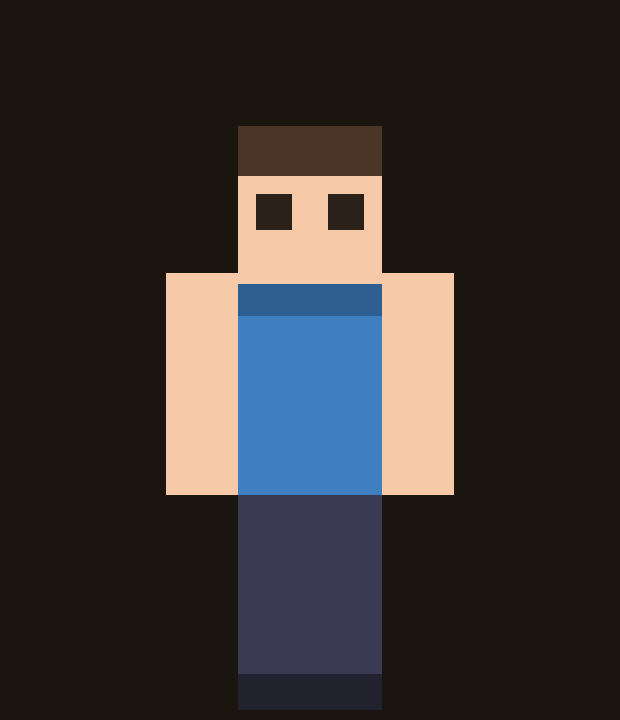

# 🎨 MC 皮肤编辑器（3D 绘制）

> 直接在 **3D 玩家模型**上画 Minecraft 皮肤，画完导出标准的 **64×64 PNG**。
> 纯前端、零依赖、双击即用 —— 一个 `index.html` + 一个 `skin3d.js` 就够了。



---

## 💡 为什么做这个

Minecraft 皮肤是一张 64×64 的图，但它是**把 6 个面摊平拼起来**的：

```
[头右][头前][头左][头后]
[身体右][身体前][身体左][身体后]
[手臂]... [腿]...
```

在平面上画的时候，你**根本分不清哪一块是脸、哪一块是后脑勺**，画眼睛经常画到耳朵上。

这个工具让你**直接在人形模型上画**，改哪个面一目了然；右上角的 2D 预览还会实时告诉你"这笔画到了纹理的哪一块"。

---

## ✨ 功能

| 功能 | 说明 |
|---|---|
| 🖌 **3D 直接画** | 左键在模型上拖动即可作画，笔刷跟着鼠标走 |
| 🧽 **4 种工具** | 画笔 / 橡皮 / 油漆桶 / 吸管 |
| 📏 **笔刷 1 / 2 / 4 / 8 px** | 皮肤只有 64×64，8px 已经是大块了 |
| 🔍 **部件聚焦** | 点头部/身体/手臂/腿 → 单独放大，**360° 旋转画背面、顶面、底面** |
| 🔄 **旋转缩放** | 拖空白处或右键拖动转模型，滚轮缩放 |
| ↩️ **撤销 / 重做** | `Ctrl+Z` / `Ctrl+Y`（最多 60 步） |
| 📥 **导入皮肤** | 支持 64×64 和老的 64×32 格式 |
| 💾 **自动保存** | 关掉网页再打开，画的东西还在（localStorage） |
| 📤 **导出** | 一键下载 64×64 PNG，直接丢进游戏 |

---

## 🎮 怎么用

1. 用浏览器打开 `index.html`（或直接访问在线地址）
2. 左边选颜色和笔刷，点模型就能画
3. 想画看不见的面 → 点「头部 / 身体 / …」聚焦，转着画
4. 画完点 **导出皮肤 PNG**

### 操作

| 操作 | 效果 |
|---|---|
| **左键拖动** | 画画 |
| **拖空白处 / 右键拖动** | 旋转模型 |
| **滚轮** | 缩放 |
| **点部件按钮 / 悬停按 `E`** | 聚焦该部件（再按 `E` 或 `Esc` 返回） |
| **`Ctrl+Z` / `Ctrl+Y`** | 撤销 / 重做 |

---

## 📐 支持的皮肤格式

- ✅ **64×64**（现代皮肤，主流）
- ✅ **64×32**（旧版皮肤，导入时会自动放到左上角）
- ✅ 经典模型（手臂 4px 宽）

---

## 🧠 实现原理（技术细节）

没有用 Three.js 之类的 3D 库，而是**纯 Canvas 2D 手写了一个小渲染器**：

1. **模型**：玩家 = 6 个长方体（头、身体、左右臂、左右腿），每个 6 个面，共 36 个面
2. **投影**：正交投影 + 绕 Y/X 轴旋转，算出每个面 4 个顶点在屏幕上的位置
3. **绘制**：按平均深度排序（画家算法，远的先画），对每个面：
   - 用 `clip()` 裁出四边形
   - 用 `transform()` 把纹理的 UV 矩形仿射映射到四边形上
   - `drawImage()` 贴图
4. **拾取**：鼠标位置 → 逐个面做"点在四边形内"判定 → 取最靠前的面 → 用逆仿射变换求出纹理像素坐标
5. **防串色**：笔刷和油漆桶都**裁剪到当前面自己的 UV 矩形**，跨面拖动不做连线 —— 保证绝不会画到隔壁区域的纹理上

---

## ⚠️ 已知限制

- 只支持**经典 4px 手臂**，纤细（slim / Alex）模型暂不支持
- **不显示外层层**（帽子、夹克、袖子那层 overlay）
- 皮肤只有 64×64，放大后是像素方块（关闭了抗锯齿，这是故意的）

---

## 🛠️ 本地运行

不需要安装任何东西：

```bash
# 方式一：直接双击 index.html
# 方式二：起个本地服务器（可选）
python -m http.server 8000
# 然后打开 http://localhost:8000
```

---

## 🌐 在线体验

> 部署到 GitHub Pages 后把链接填在这里：
> `https://<你的用户名>.github.io/mc-skin-editor/`

---


---


---
以上内容均由deepseek生成
